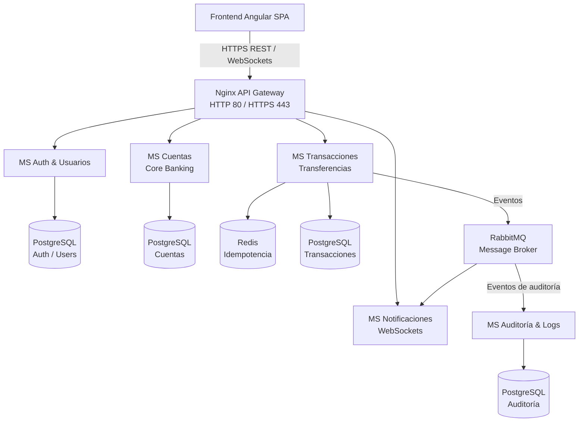
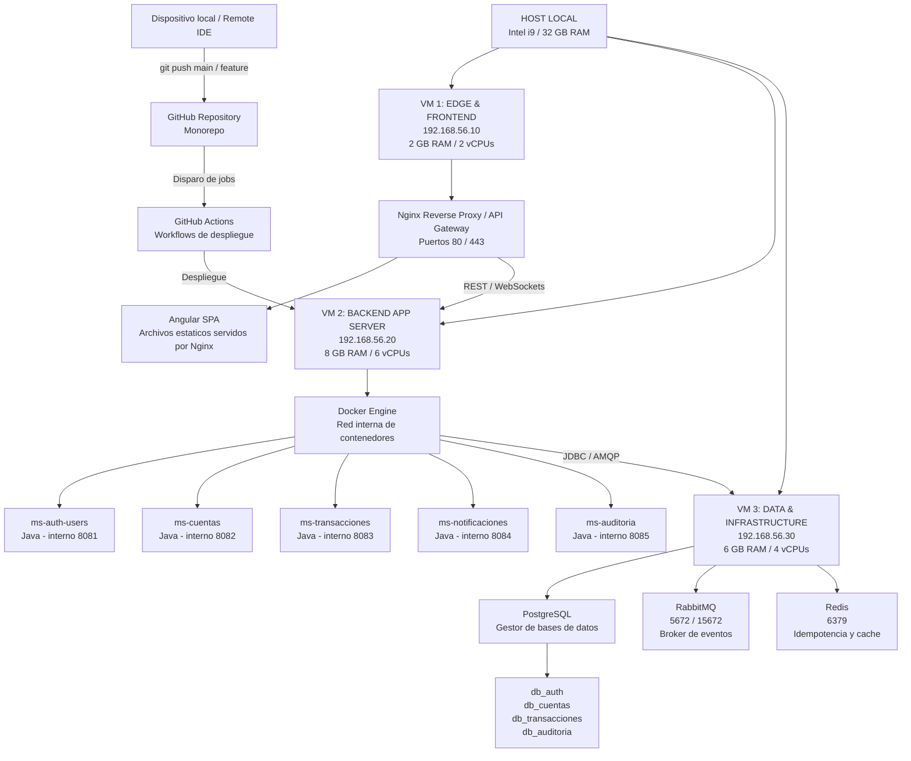

# NeoBanco Microservicios

Proyecto de portafolio técnico que simula una plataforma bancaria digital construida con una arquitectura de microservicios Java. El objetivo es demostrar el diseño, desarrollo y despliegue de un sistema distribuido con APIs REST, WebSockets, mensajería asíncrona, persistencia separada y automatización de infraestructura.

## Objetivo del portafolio

El proyecto está diseñado para mostrar, de forma práctica y verificable:

- Diseño de dominios y separación de responsabilidades en microservicios.
- Autenticación y autorización de usuarios.
- Gestión de cuentas y operaciones monetarias.
- Consistencia e idempotencia en transferencias.
- Comunicación síncrona mediante REST y asíncrona mediante RabbitMQ.
- Notificaciones en tiempo real con WebSockets.
- Auditoría, trazabilidad y manejo de errores.
- Contenerización con Docker y despliegue automatizado con GitHub Actions.

El alcance es educativo y demostrativo: se prioriza un flujo completo y bien probado sobre la cantidad de funcionalidades.

## Arquitectura



### Componentes

| Componente | Responsabilidad | Persistencia o comunicación |
| --- | --- | --- |
| Frontend Angular | Interfaz de usuario de la banca digital | REST y WebSockets |
| Nginx API Gateway | Punto de entrada único, enrutamiento y terminación HTTP/HTTPS | Puertos 80 y 443 |
| MS Auth & Usuarios | Registro, autenticación, autorización y gestión de usuarios | PostgreSQL |
| MS Cuentas | Gestión de clientes, cuentas y saldos del core bancario | PostgreSQL |
| MS Transacciones | Transferencias y operaciones monetarias | PostgreSQL y Redis |
| MS Notificaciones | Entrega de notificaciones en tiempo real | WebSockets y RabbitMQ |
| MS Auditoría & Logs | Registro de eventos relevantes y trazabilidad | PostgreSQL y RabbitMQ |
| Redis | Control de idempotencia para evitar operaciones duplicadas | Caché / claves de idempotencia |
| RabbitMQ | Transporte de eventos asíncronos entre servicios | Colas y mensajes |

## Flujo general

1. El usuario interactúa con la aplicación Angular.
2. La petición llega al Nginx API Gateway mediante HTTPS.
3. El gateway la enruta al microservicio correspondiente.
4. El microservicio valida la operación y actualiza su propia base de datos.
5. Las operaciones que requieren comunicación asíncrona publican eventos en RabbitMQ.
6. El microservicio de notificaciones distribuye actualizaciones mediante WebSockets.
7. El microservicio de auditoría conserva los eventos necesarios para trazabilidad.

## Principios de diseño

- Cada microservicio es propietario de sus datos y de su modelo de dominio.
- No se accede directamente a la base de datos de otro microservicio.
- Las operaciones monetarias deben ser idempotentes.
- Los eventos asíncronos se publican después de validar la operación de negocio.
- Las transferencias utilizan el patrón Transactional Outbox para evitar perder eventos cuando la base de datos y RabbitMQ no responden de forma atómica.
- Las operaciones críticas deben dejar trazabilidad en auditoría.
- La comunicación externa se concentra en el API Gateway.
- Los secretos y las credenciales se gestionan mediante configuración externa, nunca en el código fuente.

## Flujos funcionales previstos

### Autenticación

El usuario inicia sesión desde Angular. El gateway envía la petición a `MS Auth & Usuarios`, que valida las credenciales y devuelve el mecanismo de autenticación definido para el proyecto. Las peticiones posteriores deberán incluir las credenciales necesarias para ser autorizadas.

### Consulta de cuentas

El frontend solicita la información de las cuentas a través del gateway. `MS Cuentas` consulta su PostgreSQL y devuelve los datos permitidos para el usuario autenticado.

### Transferencia

`MS Transacciones` valida el emisor, receptor, importe y reglas de negocio. Redis se utiliza para garantizar la idempotencia de la petición y PostgreSQL para conservar la transacción. La operación y su evento se guardan en una tabla Outbox dentro de la misma transacción de base de datos. Un publicador independiente envía posteriormente el evento a RabbitMQ para notificaciones y auditoría.

El flujo principal que se pretende demostrar es:

```text
Angular -> Nginx -> MS Transacciones -> PostgreSQL / Redis
									  -> Outbox -> RabbitMQ
												   -> MS Notificaciones -> WebSocket
												   -> MS Auditoría -> PostgreSQL
```

### Notificaciones

`MS Notificaciones` consume los eventos relevantes de RabbitMQ y los envía al frontend mediante WebSockets para que el usuario reciba actualizaciones sin hacer polling.

## Estructura prevista

La estructura exacta se definirá durante la implementación. Una organización inicial posible es:

```text
neobanco-microservicios/
├── frontend/                  # Aplicación Angular SPA
├── gateway/                   # Configuración de Nginx
├── ms-auth-usuarios/          # Autenticación y usuarios
├── ms-cuentas/                # Cuentas y saldos
├── ms-transacciones/          # Transferencias e idempotencia
├── ms-notificaciones/         # WebSockets y consumo de eventos
├── ms-auditoria-logs/         # Auditoría y trazabilidad
├── infra/                     # Docker Compose, redes y configuración local
└── README.md
```

## Tecnologías

- Angular para el frontend SPA.
- Nginx como API Gateway.
- PostgreSQL para la persistencia transaccional.
- Redis para idempotencia.
- RabbitMQ como broker de mensajería.
- WebSockets para notificaciones en tiempo real.
- Java para los microservicios backend.
- Docker para empaquetado y ejecución local.
- GitHub Actions para integración y despliegue automatizado.

## Puesta en marcha

La configuración de ejecución todavía está pendiente de incorporarse. Cuando se añada el entorno local, el arranque recomendado será:

```bash
# Clonar el repositorio
git clone <url-del-repositorio>
cd neobanco-microservicios

# Arrancar la infraestructura local
docker compose up -d

# Consultar el estado de los servicios
docker compose ps
```

Los valores sensibles deberán proporcionarse mediante un archivo `.env` local o un gestor de secretos. No se deben subir credenciales reales al repositorio.

## Infraestructura actual

La infraestructura actual se ejecuta en un host local mediante tres máquinas virtuales conectadas a una red `Host-Only` (`192.168.56.0/24`). El host es un portátil Intel i9 con `32 GB` de RAM.



### Inventario de infraestructura

| Elemento | Dirección o puerto | Función |
| --- | --- | --- |
| Host local | Intel i9 / `32 GB` RAM | Equipo físico que aloja las máquinas virtuales |
| Red Host-Only | `192.168.56.0/24` | Comunicación privada entre el host y las máquinas virtuales |
| `vm-gateway` | `192.168.56.10`, `2 GB`, `2 vCPUs` | Nginx Reverse Proxy/API Gateway y archivos estáticos de Angular |
| Nginx | `80` / `443` | Entrada HTTP/HTTPS y enrutamiento hacia el backend |
| `vm-backend` | `192.168.56.20`, `8 GB`, `6 vCPUs` | Ejecución de los contenedores de los microservicios Java |
| Docker Engine | En `vm-backend` | Construye y ejecuta las imágenes de los microservicios |
| `vm-data` | `192.168.56.30`, `6 GB`, `4 vCPUs` | Servicios de datos e infraestructura compartidos |
| PostgreSQL | `5432` | Bases `db_auth`, `db_cuentas`, `db_transacciones` y `db_auditoria` |
| RabbitMQ | `5672` / `15672` | Broker AMQP de eventos y panel de administración |
| Redis | `6379` | Idempotencia y caché |

### Contenedores de backend

Los microservicios Java se ejecutan en la red interna de Docker y mantienen los siguientes puertos internos:

| Servicio | Puerto interno |
| --- | ---: |
| `ms-auth-users` | `8081` |
| `ms-cuentas` | `8082` |
| `ms-transacciones` | `8083` |
| `ms-notificaciones` | `8084` |
| `ms-auditoria` | `8085` |

### Flujo de despliegue

1. El desarrollo se realiza desde un dispositivo local o mediante un Remote IDE.
2. Los cambios se publican en la rama `main` o en una rama `feature` del repositorio GitHub.
3. GitHub Actions detecta el `push` y dispara los workflows correspondientes, almacenados en `.github/workflows/`.
4. El runner de despliegue, instalado en `vm-backend` cuando se habilite, recibe y ejecuta el job.
5. El job construye las imágenes y levanta los contenedores mediante Docker en `vm-backend`.
6. Nginx sirve el Angular SPA y enruta las peticiones REST y WebSockets al backend.
7. Los microservicios se conectan a PostgreSQL y Redis mediante JDBC y al broker mediante AMQP en `vm-data`.

### Consideraciones operativas

- La red `Host-Only` permite la comunicación privada entre las VMs, pero no sustituye una política de firewall.
- El puerto `15672` debe limitarse al acceso administrativo y no exponerse públicamente sin protección.
- Si se utiliza un runner self-hosted, debe ejecutarse con un usuario con los permisos mínimos necesarios para Docker y despliegue.
- Las credenciales de PostgreSQL, RabbitMQ, Redis y GitHub deben almacenarse como secretos del repositorio o de los entornos de GitHub Actions.
- Conviene separar los workflows de construcción, pruebas y despliegue para evitar publicar imágenes que no hayan pasado las validaciones.
- La persistencia de PostgreSQL debe respaldarse fuera de la VM de datos.
- Las reglas de firewall deben permitir únicamente el tráfico necesario entre `vm-gateway` (`192.168.56.10`), `vm-backend` (`192.168.56.20`) y `vm-data` (`192.168.56.30`).

## Contratos y eventos

Los contratos y eventos deben definirse y versionarse junto con el código:

- Contratos REST de cada microservicio, preferiblemente mediante OpenAPI.
- Esquemas de los eventos publicados en RabbitMQ.
- Claves y política de idempotencia de transferencias.
- Reglas de consistencia de saldos.
- Política de reintentos, mensajes fallidos y duplicados.
- Formato común de errores y correlación de peticiones.

El evento de transferencia debería incluir, como mínimo, un identificador único de evento, el identificador de la transferencia, el estado de la operación, fecha de creación y un `correlation-id`. Los consumidores deben procesarlo de forma idempotente.

## Evidencias técnicas

Para que el proyecto sea evaluable como portfolio, se documentarán y demostrarán estos escenarios:

- Registro e inicio de sesión de un usuario.
- Consulta de cuentas y saldos.
- Transferencia válida entre dos cuentas.
- Rechazo de una transferencia por saldo insuficiente.
- Reintento de una transferencia con la misma clave de idempotencia.
- Recepción de una notificación en tiempo real.
- Consulta del registro de auditoría.
- Ejecución de pruebas y despliegue desde GitHub Actions.

Las evidencias recomendadas son capturas del frontend, ejemplos de peticiones REST, mensajes RabbitMQ, logs con `correlation-id`, resultados de pruebas y ejecuciones exitosas del pipeline.

## Hoja de ruta

- [x] Crear el proyecto base de `ms-auth-users` (Java 25, Spring Boot 4).
- [x] Definir el contrato REST de `ms-auth-users` con OpenAPI (`ms-auth-users/openapi.yaml`).
- [x] Implementar registro de usuarios (validación, email único, hash BCrypt).
- [x] Implementar login por email y emisión de JWT.
- [x] Implementar validación de JWT en rutas protegidas.
- [x] Implementar gestión del perfil del usuario autenticado (`GET /auth/me`, `PUT /auth/me`, `PUT /auth/me/password`).
- [x] Configurar CORS para el consumo desde el frontend Angular.
- [x] Añadir pruebas unitarias y de integración de `ms-auth-users`.
- [x] Automatizar build, pruebas y despliegue de `ms-auth-users` con GitHub Actions.
- [x] Iniciar el desarrollo del frontend Angular (proyecto base, Angular Material, registro/login/logout consumiendo `ms-auth-users`).
- [x] Implementar en el frontend la gestión de perfil del usuario autenticado (`/profile`: actualizar datos y cambiar contraseña).
- [x] Automatizar build y pruebas del frontend con GitHub Actions (`.github/workflows/deploy-frontend.yml`).
- [x] Configurar Nginx en `vm-gateway` como reverse proxy y servidor de estáticos (`gateway/nginx/neobanco.conf`).
- [x] Desplegar el frontend en `vm-gateway` vía SSH/SCP desde el runner de `vm-backend` (job `deploy-to-gateway`).
- [x] Externalizar `SECRET_KEY` del JWT (`TokenJwtConfig`) a variable de entorno (`jwt.secret` / secreto `JWT_SECRET` en GitHub Actions).
- [x] Extraer una librería compartida de validación de JWT (`common-security`) para los microservicios consumidores (ver [ADR-0004](docs/adr/0004-common-security-modulo-independiente.md)), publicada en GitHub Packages.
- [x] Crear el proyecto base de `ms-cuentas` (Java 25, Spring Boot 4, `common-security` como dependencia).
- [x] Implementar CRUD de cuentas (`crear`, `listar`, `detalle`, `cambio de estado`) con validación de propiedad (403 vs 404) por usuario.
- [x] Implementar `débito`/`crédito` internos (`/internal/account/...`), separados del controller público y bloqueados a nivel de Nginx (`gateway/nginx/neobanco.conf`) para uso exclusivo de `ms-transacciones`.
- [x] Añadir pruebas unitarias y de integración de `ms-cuentas` (perfil H2 en memoria).
- [x] Automatizar build, pruebas y despliegue de `ms-cuentas` con GitHub Actions (`.github/workflows/deploy-cuentas.yml`).
- [x] Hacer público el repositorio: migrar los jobs de verificación (`test-and-verify`) de `self-hosted` a `ubuntu-latest` en todos los workflows, dejando `self-hosted` solo para los jobs de despliegue gatillados por `push` a `main`.
- [ ] Crear los proyectos base del resto de microservicios (`ms-transacciones` en progreso, `ms-notificaciones`, `ms-auditoria` pendientes).
- [ ] Definir los contratos REST del resto de microservicios con OpenAPI (`ms-cuentas` y `ms-transacciones` pendientes).
- [ ] Implementar transferencias entre cuentas en `ms-transacciones` (modelo `Transaction` e idempotencia por `idempotencyKey` en progreso).
- [ ] Diseñar la gestión administrativa de cuentas (desbloqueo, back-office) — ver [ADR-0006](docs/adr/0006-area-administrativa-pendiente.md), diferido hasta definir roles/autorización administrativa.
- [ ] Añadir Redis para idempotencia.
- [ ] Implementar Transactional Outbox y publicación en RabbitMQ.
- [ ] Implementar notificaciones WebSocket.
- [ ] Implementar auditoría y logs estructurados.
- [ ] Añadir pruebas de integración y de flujo completo entre microservicios.
- [ ] Añadir observabilidad, backups y documentación operativa.

## Estado del proyecto

El microservicio `ms-auth-users` es el primero en implementarse y ya cuenta con un flujo funcional de:

- Registro de usuarios, con validación de campos y de email único.
- Login por email con emisión de JWT (HS256) y expiración de 1 hora.
- Validación de JWT en rutas protegidas mediante un filtro de Spring Security.
- Gestión del perfil del usuario autenticado: consulta (`GET /auth/me`),
  actualización de nombre/email (`PUT /auth/me`, con validación de email
  único) y cambio de contraseña (`PUT /auth/me/password`, con
  verificación de la contraseña actual). No se implementan roles.
- Configuración de CORS para permitir el consumo desde el frontend Angular.
- Contrato OpenAPI documentado y sincronizado con el comportamiento real del servicio.
- Cobertura de pruebas unitarias (servicios) y de integración (registro, login,
  validación de JWT y gestión de perfil/contraseña) sobre una base de datos H2 en memoria.
- Pipeline de CI/CD (`.github/workflows/deploy-auth.yml`) que valida la compilación en cada Pull Request y despliega en contenedor Docker al hacer merge a `main`.

El resto de microservicios (`ms-notificaciones`, `ms-auditoria`) aún no se han creado. La infraestructura de las 3 VMs y las bases de datos ya están desplegadas y operativas.

El microservicio `ms-cuentas` ya cuenta con un flujo funcional de:

- CRUD de cuentas (`POST /account`, `GET /account`, `GET /account/{numeroCuenta}`, `PATCH /account/{numeroCuenta}/estado`), con validación de propiedad (403 si la cuenta no pertenece al usuario autenticado, 404 si no existe).
- Débito y crédito internos (`POST /internal/account/{numeroCuenta}/debito` y `/credito`), separados en un controller propio (`InternalAccountController`) y bloqueados a nivel de Nginx para que solo sean alcanzables desde la red interna (pensado para ser consumidos por `ms-transacciones`, no por el frontend).
- Reglas de negocio: una cuenta `BLOQUEADA` no puede cambiar de estado en ninguna dirección sin intervención administrativa (ver ADR-0006), y ni `BLOQUEADA` ni `INACTIVA` permiten operaciones de débito/crédito.
- Seguridad compartida con `ms-auth-users` mediante `common-security` (mismo secreto JWT, mismo filtro de validación).
- Cobertura de pruebas unitarias (Mockito) y de integración (MockMvc + H2 + JWT real) sobre las reglas de ownership, estado y saldo.
- Pipeline de CI/CD (`.github/workflows/deploy-cuentas.yml`) con el mismo patrón seguro de `ms-auth-users`.

`ms-transacciones` está en desarrollo inicial: modelo `Transaction` (estados `PENDIENTE`/`COMPLETADA`/`FALLIDA`/`REVERTIDA`, pensado como una Saga simple con compensación manual), DTO `TransferenciaRequest` con clave de idempotencia, y configuración de seguridad ya alineada con el resto de servicios.

El repositorio ya es público; los workflows de CI/CD fueron ajustados para que los jobs de verificación (`test-and-verify`) corran en `ubuntu-latest` en lugar de `self-hosted`, evitando exponer las VMs a ejecución de código de Pull Requests externos.

El frontend Angular (`frontend/`) ya cuenta con:

- Proyecto base en Angular 22 con Angular Material (tema M3) y animaciones.
- Formularios reactivos de registro y login, con manejo de errores de validación devueltos por el backend.
- Servicio de autenticación (`AuthService`) basado en signals, con persistencia de token/email en `localStorage`.
- Interceptor HTTP que adjunta el JWT a las peticiones salientes (excluyendo `/auth/register` y `/auth/login`) y guard de rutas que protege vistas autenticadas.
- Flujo completo validado manualmente en `ng serve` contra el backend real de `ms-auth-users` (registro, login y acceso a una vista protegida).
- Sección de perfil (`/profile`) para actualizar nombre/email y cambiar la contraseña, consumiendo `GET/PUT /auth/me` y `PUT /auth/me/password`.
- Pipeline de CI/CD (`.github/workflows/deploy-frontend.yml`) que instala dependencias, corre pruebas unitarias y verifica el build en cada Pull Request, y despliega el build de producción a `vm-gateway` vía SSH/SCP al hacer merge a `main`.

`vm-gateway` cuenta con Nginx configurado (`gateway/nginx/neobanco.conf`) como reverse proxy hacia `ms-auth-users` (`/api/` → `vm-backend:8081`) y servidor de los archivos estáticos del frontend.

## Aviso

Este proyecto es un portfolio técnico con fines educativos y de simulación. No está diseñado para gestionar dinero real ni para utilizarse en un entorno bancario productivo sin un análisis de seguridad, cumplimiento normativo, resiliencia, observabilidad y operación adecuado.