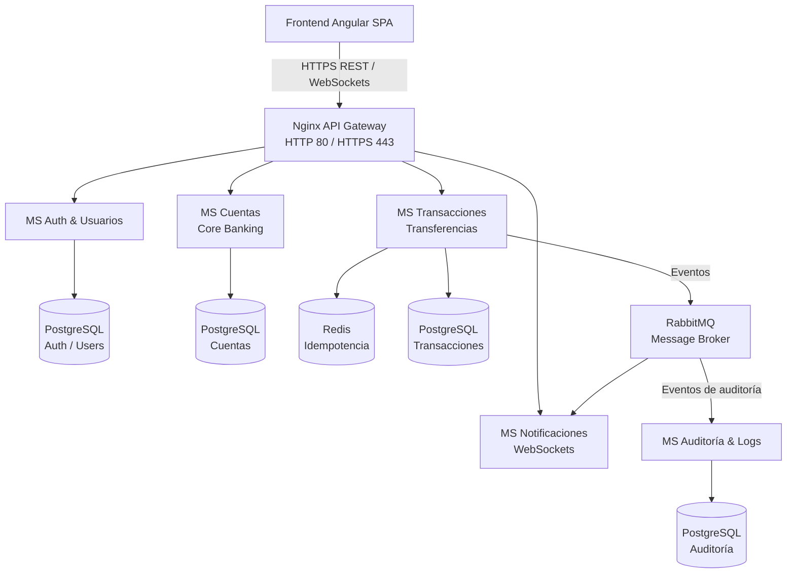
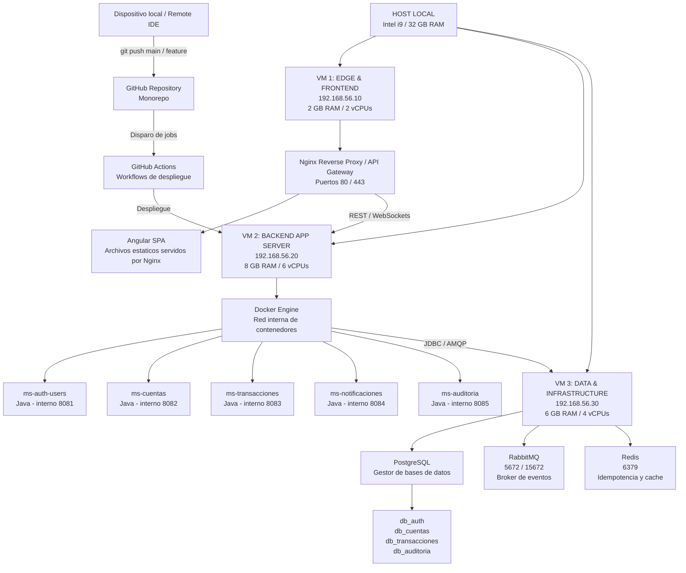

# NeoBanco Microservicios

Proyecto de simulación de un banco digital construido con una arquitectura de microservicios. El objetivo es modelar los principales flujos de un neobanco, manteniendo cada capacidad de negocio aislada y comunicada mediante APIs REST, WebSockets y eventos asíncronos.

## Arquitectura



### Componentes

| Componente | Responsabilidad | Persistencia o comunicación |
| --- | --- | --- |
| Frontend Angular | Interfaz de usuario de la banca digital | REST y WebSockets |
| Nginx API Gateway | Punto de entrada único, enrutamiento y terminación HTTP/HTTPS | Puertos 80 y 443 |
| MS Auth & Usuarios | Registro, autenticación, autorización y gestión de usuarios | PostgreSQL |
| MS Cuentas | Gestión de clientes, cuentas y saldos del core bancario | PostgreSQL |
| MS Transacciones | Transferencias y operaciones monetarias | PostgreSQL y Redis |
| MS Notificaciones | Entrega de notificaciones en tiempo real | WebSockets y RabbitMQ |
| MS Auditoría & Logs | Registro de eventos relevantes y trazabilidad | PostgreSQL y RabbitMQ |
| Redis | Control de idempotencia para evitar operaciones duplicadas | Caché / claves de idempotencia |
| RabbitMQ | Transporte de eventos asíncronos entre servicios | Colas y mensajes |

## Flujo general

1. El usuario interactúa con la aplicación Angular.
2. La petición llega al Nginx API Gateway mediante HTTPS.
3. El gateway la enruta al microservicio correspondiente.
4. El microservicio valida la operación y actualiza su propia base de datos.
5. Las operaciones que requieren comunicación asíncrona publican eventos en RabbitMQ.
6. El microservicio de notificaciones distribuye actualizaciones mediante WebSockets.
7. El microservicio de auditoría conserva los eventos necesarios para trazabilidad.

## Principios de diseño

- Cada microservicio es propietario de sus datos y de su modelo de dominio.
- No se accede directamente a la base de datos de otro microservicio.
- Las operaciones monetarias deben ser idempotentes.
- Los eventos asíncronos se publican después de validar la operación de negocio.
- Las operaciones críticas deben dejar trazabilidad en auditoría.
- La comunicación externa se concentra en el API Gateway.
- Los secretos y las credenciales se gestionan mediante configuración externa, nunca en el código fuente.

## Flujos funcionales previstos

### Autenticación

El usuario inicia sesión desde Angular. El gateway envía la petición a `MS Auth & Usuarios`, que valida las credenciales y devuelve el mecanismo de autenticación definido para el proyecto. Las peticiones posteriores deberán incluir las credenciales necesarias para ser autorizadas.

### Consulta de cuentas

El frontend solicita la información de las cuentas a través del gateway. `MS Cuentas` consulta su PostgreSQL y devuelve los datos permitidos para el usuario autenticado.

### Transferencia

`MS Transacciones` valida el emisor, receptor, importe y reglas de negocio. Redis se utiliza para garantizar la idempotencia de la petición y PostgreSQL para conservar la transacción. Una vez aceptada, el servicio publica un evento en RabbitMQ para notificaciones y auditoría.

### Notificaciones

`MS Notificaciones` consume los eventos relevantes de RabbitMQ y los envía al frontend mediante WebSockets para que el usuario reciba actualizaciones sin hacer polling.

## Estructura prevista

La estructura exacta se definirá durante la implementación. Una organización inicial posible es:

```text
neobanco-microservicios/
├── frontend/                  # Aplicación Angular SPA
├── gateway/                   # Configuración de Nginx
├── ms-auth-usuarios/          # Autenticación y usuarios
├── ms-cuentas/                # Cuentas y saldos
├── ms-transacciones/          # Transferencias e idempotencia
├── ms-notificaciones/         # WebSockets y consumo de eventos
├── ms-auditoria-logs/         # Auditoría y trazabilidad
├── infra/                     # Docker Compose, redes y configuración local
└── README.md
```

## Tecnologías

- Angular para el frontend SPA.
- Nginx como API Gateway.
- PostgreSQL para la persistencia transaccional.
- Redis para idempotencia.
- RabbitMQ como broker de mensajería.
- WebSockets para notificaciones en tiempo real.
- El lenguaje y framework de cada microservicio quedan pendientes de definir.

## Puesta en marcha

La configuración de ejecución todavía está pendiente de incorporarse. Cuando se añada el entorno local, el arranque recomendado será:

```bash
# Clonar el repositorio
git clone <url-del-repositorio>
cd neobanco-microservicios

# Arrancar la infraestructura local
docker compose up -d

# Consultar el estado de los servicios
docker compose ps
```

Los valores sensibles deberán proporcionarse mediante un archivo `.env` local o un gestor de secretos. No se deben subir credenciales reales al repositorio.

## Infraestructura actual

La infraestructura actual se ejecuta en un host local mediante tres máquinas virtuales conectadas a una red `Host-Only` (`192.168.56.0/24`). El host es un portátil Intel i9 con `32 GB` de RAM.



### Inventario de infraestructura

| Elemento | Dirección o puerto | Función |
| --- | --- | --- |
| Host local | Intel i9 / `32 GB` RAM | Equipo físico que aloja las máquinas virtuales |
| Red Host-Only | `192.168.56.0/24` | Comunicación privada entre el host y las máquinas virtuales |
| `vm-gateway` | `192.168.56.10`, `2 GB`, `2 vCPUs` | Nginx Reverse Proxy/API Gateway y archivos estáticos de Angular |
| Nginx | `80` / `443` | Entrada HTTP/HTTPS y enrutamiento hacia el backend |
| `vm-backend` | `192.168.56.20`, `8 GB`, `6 vCPUs` | Ejecución de los contenedores de los microservicios Java |
| Docker Engine | En `vm-backend` | Construye y ejecuta las imágenes de los microservicios |
| `vm-data` | `192.168.56.30`, `6 GB`, `4 vCPUs` | Servicios de datos e infraestructura compartidos |
| PostgreSQL | `5432` | Bases `db_auth`, `db_cuentas`, `db_transacciones` y `db_auditoria` |
| RabbitMQ | `5672` / `15672` | Broker AMQP de eventos y panel de administración |
| Redis | `6379` | Idempotencia y caché |

### Contenedores de backend

Los microservicios Java se ejecutan en la red interna de Docker y mantienen los siguientes puertos internos:

| Servicio | Puerto interno |
| --- | ---: |
| `ms-auth-users` | `8081` |
| `ms-cuentas` | `8082` |
| `ms-transacciones` | `8083` |
| `ms-notificaciones` | `8084` |
| `ms-auditoria` | `8085` |

### Flujo de despliegue

1. El desarrollo se realiza desde un dispositivo local o mediante un Remote IDE.
2. Los cambios se publican en la rama `main` o en una rama `feature` del repositorio GitHub.
3. GitHub Actions detecta el `push` y dispara los workflows correspondientes, almacenados en `.github/workflows/`.
4. El runner de despliegue, instalado en `vm-backend` cuando se habilite, recibe y ejecuta el job.
5. El job construye las imágenes y levanta los contenedores mediante Docker en `vm-backend`.
6. Nginx sirve el Angular SPA y enruta las peticiones REST y WebSockets al backend.
7. Los microservicios se conectan a PostgreSQL y Redis mediante JDBC y al broker mediante AMQP en `vm-data`.

### Consideraciones operativas

- La red `Host-Only` permite la comunicación privada entre las VMs, pero no sustituye una política de firewall.
- El puerto `15672` debe limitarse al acceso administrativo y no exponerse públicamente sin protección.
- Si se utiliza un runner self-hosted, debe ejecutarse con un usuario con los permisos mínimos necesarios para Docker y despliegue.
- Las credenciales de PostgreSQL, RabbitMQ, Redis y GitHub deben almacenarse como secretos del repositorio o de los entornos de GitHub Actions.
- Conviene separar los workflows de construcción, pruebas y despliegue para evitar publicar imágenes que no hayan pasado las validaciones.
- La persistencia de PostgreSQL debe respaldarse fuera de la VM de datos.
- Las reglas de firewall deben permitir únicamente el tráfico necesario entre `vm-gateway` (`192.168.56.10`), `vm-backend` (`192.168.56.20`) y `vm-data` (`192.168.56.30`).

## Contratos y eventos

Antes de implementar los servicios conviene definir y versionar:

- Contratos REST de cada microservicio, preferiblemente mediante OpenAPI.
- Esquemas de los eventos publicados en RabbitMQ.
- Claves y política de idempotencia de transferencias.
- Reglas de consistencia de saldos.
- Política de reintentos, mensajes fallidos y duplicados.
- Formato común de errores y correlación de peticiones.

## Estado del proyecto

Este repositorio se encuentra en la fase inicial de definición de arquitectura. El diagrama y este documento describen la solución objetivo; la implementación de los microservicios, la infraestructura local, los contratos y las pruebas se incorporarán progresivamente.

## Aviso

Este proyecto tiene fines educativos y de simulación. No está diseñado para gestionar dinero real ni para utilizarse en un entorno bancario productivo sin un análisis de seguridad, cumplimiento normativo, resiliencia, observabilidad y operación adecuado.